# Speech-to-Text Studio

<picture>
  <source media="(max-width: 640px) and (prefers-reduced-motion: reduce)" srcset="docs/assets/speech-studio-mobile-static.svg">
  <source media="(prefers-reduced-motion: reduce)" srcset="docs/assets/speech-studio-static.svg">
  <source media="(max-width: 640px)" srcset="docs/assets/speech-studio-mobile.svg">
  
</picture>

Compare five managed transcription services on the same audio and references.
Listen to the source, inspect word-level differences, and trace each result to its
immutable evidence.

[Run locally](#run-locally)
&nbsp; | &nbsp; [Deployment guide](docs/deployment.md)
&nbsp; | &nbsp; [MIT license](LICENSE)

## What you get

- A preserved **26-sample LibriSpeech test-clean baseline** across five solutions.
- Your own immutable English datasets: up to ten matching audio/reference pairs,
  validated before publication.
- Native FLAC, WAV and MP3 playback, seeking and downloads, plus reference/hypothesis
  alignment and result-level comparisons.
- Separate quality, cost, latency, usage and reliability evidence. No blended score
  or universal winner.
- Durable runs, explicit retries and downloadable JSON/CSV reports in the existing
  Evidence Ledger workspace.

The installed pilot is a small, duration-stratified sample, **not the full test-clean
benchmark or a production ranking**. Compare results only when dataset and evaluated
coverage match. See the [benchmark brief](BENCHMARK.md).

## Five managed solutions

| Solution | Managed path |
|---|---|
| Azure Speech fast | Standard fast transcription |
| `gpt-transcribe` | Azure OpenAI Audio deployment |
| Managed `whisper` | Azure OpenAI Audio deployment |
| MAI-Transcribe-1.5 | Azure Speech fast with the explicit enhanced-mode model |
| MAI-Transcribe-2 | Azure Speech fast with the explicit enhanced-mode model |

All five receive the validated original audio, **not the reference text or reference
metadata**. Hosted deployments use Microsoft Entra managed identity rather than exposing
provider keys. API/model configuration and evaluation details are in
[speech operations](docs/speech-to-text.md).

## From files to evidence

<picture>
  <source media="(max-width: 640px) and (prefers-reduced-motion: reduce)" srcset="docs/assets/speech-workflow-mobile-static.svg">
  <source media="(prefers-reduced-motion: reduce)" srcset="docs/assets/speech-workflow-static.svg">
  <source media="(max-width: 640px)" srcset="docs/assets/speech-workflow-mobile.svg">
  
</picture>

1. **Choose data.** Use the pinned baseline or select matching audio and TXT files.
2. **Publish a revision.** Acknowledge public visibility, sharing rights, English and
   retention. Files upload separately and can resume after interruption; incomplete
   or invalid datasets are never published.
3. **Launch a run.** Select solutions and maximum attempts. Launch authorizes their
   paid calls when hosted execution is enabled; no extra network checkbox is required.
   Hosted runs allow at most three total attempts per task.
4. **Inspect the result.** Review independent metrics, play a sample, compare aligned
   words, then open operational evidence or download the report.

The illustrations are explanatory, not live telemetry. Motion stops after a short
sequence, every label remains visible without animation, and reduced-motion
preferences select dedicated still images.

## Bring your own audio

Select files directly. Each pair must have **exactly the same basename and case**:

```text
sample-01.wav   + sample-01.txt
sample-02.mp3   + sample-02.txt
```

| Boundary | Public upload rule |
|---|---|
| Language and scoring | English only; pinned `librispeech-english-v1` normalization and WER |
| Pair count | 1-10 pairs; one `.flac`, `.wav` or `.mp3` plus one `.txt` per pair |
| Audio | At most 25,000,000 bytes and 300 seconds per file |
| Reference | Strict UTF-8, at most 16,384 bytes, with a nonempty normalized transcript |
| Whole dataset | At most 250,000,000 file bytes and 1,800 audio seconds |
| Publication | Validated media, safe names and complete pairing; original bytes stay unchanged |

No ZIPs, directories, remote URLs, microphone capture or active documents. Duplicate
and case-colliding names are rejected rather than guessed. The installed 26-sample
revision has its own validation contract and is not subject to the ten-pair upload cap.

## Five metric families, kept separate

| Family | What to inspect |
|---|---|
| **Quality** | Corpus WER, substitutions, deletions, insertions and aligned words |
| **Cost** | Recorded amounts or unknowns, separate dated estimates, pricing sources and retry coverage |
| **Latency** | Provider request time, attempt duration, queue/cooldown wait and end-to-end elapsed time |
| **Usage** | Recorded calls, submitted audio seconds and available provider-reported usage |
| **Reliability** | Evaluated coverage, task outcomes, retries and all recorded attempts |

WER is total word errors divided by total reference words, not an average of sentence
percentages. Failed calls are not perfect transcriptions. The preserved pilot's original
price snapshots remain **unknown**, not free. The UI separately shows conditional
current-rate estimates from reviewed exact-model meters, including recorded retries.
Unknown or partial usage stays explicit; estimates are **not billed charges** and do
not change original reports. See [pricing basis and sources](docs/speech-to-text.md#current-rate-cost-estimates).

## Retention and operational limits

Uploaded datasets and everything derived from them expire **ten days after publication**.
Viewing, retries, exports and new runs do not extend the deadline. The installed
LibriSpeech revision and original baseline pilot are pinned; ordinary new runs on that
installed revision expire ten days after acceptance.

Access stops at expiry, including partial downloads. A resumable reaper removes
unshared data and indexes; physical cleanup resumes after outages. There is no extra
Blob soft-delete/version-history window for uploads. Downloaded copies and
provider-side retention cannot be recalled.

The service keeps one current-generation coordinator: new speech runs permit up to
five concurrent tasks globally and one per solution; older manifests stay serial.
Provider quotas/shared cooldowns, attempt ceilings, bounded queues and temporary
`429`/`503` backpressure remain in force. Rare duplicate or
overlapping external calls can occur after interruption, takeover or lost responses.
**Physical non-overlap and exactly-once billing are not guaranteed.**

## Run locally

Requires Python 3.12 or later. Use a virtual environment. The synthetic example runs
offline without an Azure account, credentials, audio download or paid service:

```powershell
python -m venv .venv
.\.venv\Scripts\Activate.ps1
python -m pip install -r requirements.lock
python -m pip install --no-deps -e .
ai-bench run synthetic_text_intent
ai-bench serve
```

Open [the local synthetic workspace](http://127.0.0.1:8000/?benchmark=synthetic_text_intent).
Local state stays under `.ai-bench/`. The packaged frontend is included; Node.js is
needed only when changing frontend source.

<details>
<summary>Frontend development and quality gates</summary>

Keep the Python virtual environment active:

```powershell
Push-Location frontend
npm ci
npm test
npm run typecheck
npm run build
Pop-Location
```

Edit `frontend/src`, not the generated hashed assets under `src/ai_bench/web/static`.
See [AGENTS.md](AGENTS.md) for the full browser, package, infrastructure and documentation
gates. These local gates do not deploy Azure or call a paid model.

</details>

## Deploy your own studio

Use the existing **Azure Developer CLI + Bicep** workflow in the
[deployment guide](docs/deployment.md), with the
[Azure security baseline](docs/azure-security-baseline.md).
Keep deployment plans, proof, environment state and resource identifiers outside source
control; `.azure/` is ignored.

The hosted design uses one Linux App Service instance, private managed-identity Blob
storage and Azure Table coordination. SQLite/filesystem coordination is local-only.
It reuses two existing AI Services accounts in one selected resource group, preserves
their deployments/settings, and applies only reviewed provider-network changes.
Application ingress can be public; SCM is separately Entra/RBAC-protected. The explicit MVP
mode removes the SCM operator-IP gate without enabling basic publishing authentication.
Restricted non-MVP defaults remain available. Storage and Key Vault remain
private. Baseline import, live conformance, restart and provider evidence are required
before declaring a deployment proven.

No real audio, reference dataset, provider configuration, keys, generated results or
deployment state are distributed in the repository. Follow the external publication
and attribution instructions in [speech operations](docs/speech-to-text.md).

## Documentation and extension points

| Document | Purpose |
|---|---|
| [BENCHMARK.md](BENCHMARK.md) | Speech datasets, managed paths, normalization and evaluation contract |
| [Speech operations](docs/speech-to-text.md) | External data publication, model configuration and evidence |
| [PRODUCT.md](PRODUCT.md) | Product invariants and independent metric families |
| [DESIGN.md](DESIGN.md) | Platform-owned Evidence Ledger and accessibility rules |
| [Benchmark contract](docs/benchmark-contract.md) | Generic pack, adapter, evaluator, viewer and storage boundaries |
| [Agent playbook](docs/agent-playbook.md) | Discovery through cleanup |
| [AGENTS.md](AGENTS.md) | Authoritative contributor workflow and quality gates |

Platform code lives in `src/ai_bench`; speech-specific behavior lives in
`benchmark_packs/speech_to_text`. To build another benchmark, use the documented pack
contract and `ai-bench scaffold` rather than adding pack-specific branches to core.
